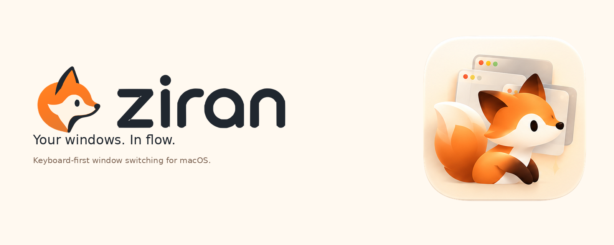

<p align="center">
  
</p>

# Ziran

Keyboard-first window switcher for macOS (menubar app, macOS 14+).

Every action has a keyboard shortcut, and each view shows the keys that work in it. Mouse support is optional.

## Install

```sh
brew install --cask epulla/tap/ziran
```

The app is ad-hoc signed and not notarized: on first launch, allow it in System Settings → Privacy & Security → **Open Anyway**. After each upgrade, you may need to remove and re-add Ziran in Accessibility settings.

Or download `Ziran-X.Y.Z.zip` from [Releases](https://github.com/epulla/ziran/releases), unzip, move `Ziran.app` to Applications, and open it with right-click → Open (the app is ad-hoc signed).

Or build app bundle:

```sh
make bundle
open dist/Ziran.app
```

Grant Accessibility permission in System Settings → Privacy & Security →
Accessibility. The app is ad-hoc signed. After rebuilding, you may need to
remove and re-add Ziran in Accessibility settings.

## Usage

| Key or action | Result |
| --- | --- |
| ⌥Tab | Open app strip |
| ⌥⇧Tab | Select previous app in strip |
| ⌥` | Open window dropdown for current app; repeat ` / ⇧` to cycle (wraps); ↑ at top to search its windows |
| ↓ | Open window dropdown for selected app |
| ↑ | Open filterable list of all windows |
| Release ⌥ or press ↩ | Switch to selected item |
| Esc | Close switcher |
| = (hold ⌥) in strip/dropdown; ⌘= in list/search | Pin or unpin selected window |
| ⌘↑↓ on a pinned window in dropdown/list | Reorder pins |
| W (hold ⌥) in dropdown; ⌘W in list/search | Close selected window |
| W (hold ⌥) in strip | Close all windows of selected app |
| Q (hold ⌥) in strip | Quit selected app |
| 1–9 (hold ⌥) in strip/dropdown; ⌘1–9 in list/search | Jump straight to Nth item (number row or keypad) |
| Hover | Select item |
| Click | Switch to item |
| Scroll | Move selection |
| Pin icon | Pin item |

Pins last until Ziran quits and sort first in the dropdown and list. Drag a pinned window to reorder pins.

### Quick nav

Bookmarks for apps, folders, files and web pages, shown in a box beside the strip and dropdown. Running apps come forward, quit apps launch, files open in their app, and pages open in your browser. Bookmarks whose file or app no longer exists are removed.

| Key | Result |
| --- | --- |
| − in strip/dropdown | Bookmark the selected window, or remove it if saved; the box names what gets saved |
| ⇧1–9 while switcher is open (except list/search) | Open Nth bookmark |
| → in strip/dropdown | Move into quick nav; ↑↓ move, ↩ or release ⌥ opens, − removes, ← goes back |
| ⌘↑ / ⌘↓ in quick nav | Move the selected bookmark up / down |
| Drag a row | Reorder bookmarks |

⌥− saves the window's document when the app reports one (a browser's page, a terminal's working folder, an open file), the folder for a Finder window, and otherwise the app. Finder folders need a one-time permission for Ziran to control Finder.

### Templates

Saved window layouts, shown in a box on the left of the strip and dropdown. A template places each app's window into a half, quarter, or full screen on the display the switcher is on, launching apps that aren't running. The box shows a preview of each template, plus a dimmed preview of the current layout when it isn't saved yet. Click `+` by the heading to save it; hover a template or quick nav row and click `×` to remove it.

| Key | Result |
| --- | --- |
| ← in strip/dropdown | Move into templates; ↑↓ move, ↩ or release ⌥ applies, → goes back |
| ⌘↑ / ⌘↓ in templates | Move the selected template up / down |
| Drag a row | Reorder templates |
| = in templates | Save the visible windows on this display as a template, named after their apps |
| − in templates | Remove the selected template |
| ⌘1–9 while switcher is open (except list/search) | Apply Nth template |

### Window shortcuts

Resize the focused window from anywhere. Also listed under menubar icon → Window.

| Key | Result |
| --- | --- |
| ⌃⌥← / ⌃⌥→ | Left / right half; repeat to cycle ½ → ⅔ → ⅓ |
| ⌃⌥↑ / ⌃⌥↓ | Top / bottom half |
| ⌃⌥U / I / J / K | Top-left / top-right / bottom-left / bottom-right quarter |
| ⌃⌥↩ or ⌃⌥F | Maximize |
| ⌃⌥C | Center |
| ⌃⌥⌫ | Restore size before the first Ziran resize |
| ⌃⌥⌘← / ⌃⌥⌘→ | Move to previous / next display |

## Preferences

Open menubar icon → Preferences… (⌘,).

- Font size: 11–28 pt
- Icon size: 48–160 pt for strip tiles
- Launch at login (on by default)
- Window resize shortcuts on/off
- Quick Nav tab: add files, folders, apps (⌘O) or web addresses (⌘L), reorder (⌘↑/⌘↓ or drag), and remove (⌫) bookmarks

## Development

```sh
make build
make test
make lint
make format
make bundle
make run
```

Swift 6, SwiftPM, no dependencies. See `AGENTS.md` for conventions.

`make run` launches the bare executable without bundle resources, so the menu bar shows a fallback symbol instead of the fox. Use `make bundle && open dist/Ziran.app` to see the branded app and menu bar icons.

Brand assets (logos, mascot, palette, social preview, editable icon sources) live in [`docs/brand`](docs/brand/README.md).

## Acknowledgements

The switcher panel and preferences design are adapted from [AltTab](https://github.com/sr3d/AltTab) by Alex Le, used under the MIT License (Copyright (c) 2026 Alex Le).

Window shortcut defaults follow [Rectangle](https://github.com/rxhanson/Rectangle) by Ryan Hanson.

## License

MIT — see [LICENSE](LICENSE).
